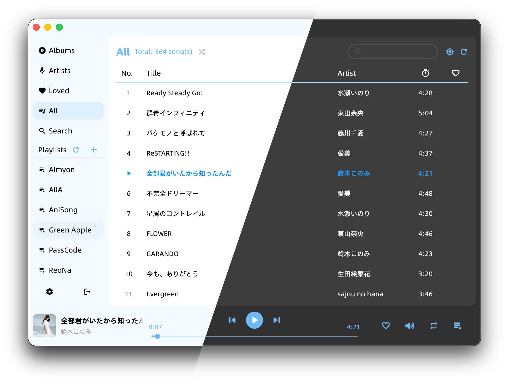
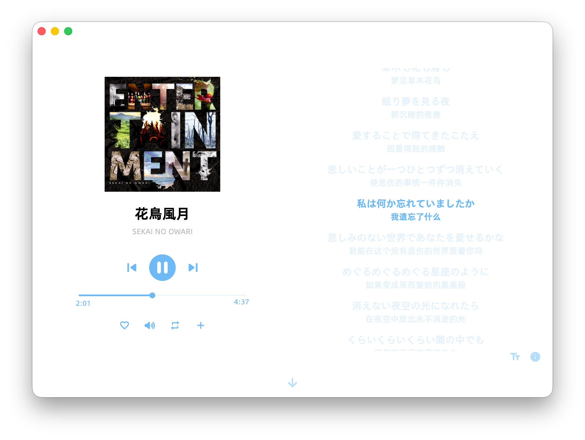

# netPlayer Next

[English Version](/documents/en.md) | 简体中文

## 简介


[](/DISCLAIMER.md)

<a href="https://apps.microsoft.com/detail/9nfmtfpz1zct?referrer=appbadge&mode=direct">
	
</a>

**netPlayer Next** 是一款基于 Subsonic (Navidrome) API 开发的现代桌面端音乐播放器客户端。你可以[**点击这里**](https://www.navidrome.org/docs/installation/)查看如何搭建 Navidrome 音乐服务器（推荐）。

如果你正在寻找移动端版本，请访问 [**netPlayer Mobile**](https://github.com/Zhoucheng133/netPlayer-Mobile) 仓库。

> [!NOTE]
> - 在使用前，请确保运行 netPlayer 的设备能够正常通过网络连接到你的音乐服务器。
> - 如遇到任何 Bug 或有新功能建议，欢迎提交 [Issues](https://github.com/Zhoucheng133/netPlayer-Next/issues)。

**★ netPlayer Next** | [**netPlayer Mobile**](https://github.com/Zhoucheng133/netPlayer-Mobile)

## 目录

- [简介](#简介)
- [软件截图](#软件截图)
- [主要功能与使用](#主要功能与使用)
- [多语言支持](#多语言支持)
- [WebSocket 服务与二次开发](#websocket-服务与二次开发)
- [常见问题 (FAQ)](#常见问题-faq)
- [相关链接](#相关链接)
- [本地开发与打包指南](#本地开发与打包指南)
- [相关 API](#相关-api)

## 软件截图

> [!TIP]
> 软件现已支持自定义主题色与深色模式！





## 主要功能与使用

> [!TIP]
> - **歌单与专辑数量说明**：受限于 Subsonic API，“所有歌曲”和“专辑”默认最多显示 500 首/张（随机抽样排序展示）。
> - **Navidrome 增强支持**：从 `v3.6.2` 版本开始，支持完整显示 Navidrome 服务的“所有歌曲”和“专辑”（默认开启，优先检查服务端是否支持）。

### 快捷键指南

#### App 内快捷键
- **空格 (Space)**：播放 / 暂停
- **`Command` + `→`** (macOS) / **`Ctrl` + `→`** (Windows)：下一首
- **`Command` + `←`** (macOS) / **`Ctrl` + `←`** (Windows)：上一首
- **`Command` + `L`** (macOS) / **`Ctrl` + `L`** (Windows)：显示 / 隐藏歌词

#### 全局快捷键
- **媒体播放键** (macOS & Windows) 或 **`Ctrl` + `Alt` + `空格`** (Windows)：播放 / 暂停
- **媒体下一首键** (macOS & Windows) 或 **`Ctrl` + `Alt` + `→`** (Windows)：下一首
- **媒体上一首键** (macOS & Windows) 或 **`Ctrl` + `Alt` + `←`** (Windows)：上一首

### 桌面悬浮歌词
- 你可以在主界面播放栏进度条右侧的歌词按钮打开/关闭悬浮歌词。
- 也可以在主界面的**设置**页面中，自定义该按钮的行为（控制显示浮动歌词或显示主页面歌词）。
- 在设置页面中，还可以调整浮动歌词的字体大小和透明度，歌词颜色将自动跟随当前主题色。

## 多语言支持

- 多语言配置文件位于 `lib/lang` 目录。
- 自 `v3.2.0` 版本起正式支持多语言切换。如果您发现某些翻译不够准确，欢迎提交 PR 或 Issue 共同完善。

## WebSocket 服务与二次开发

> [!NOTE]
> 此功能需要 **v3.0.0** 及以上版本，以下接口适用于 **v3.3.0** 或更新版本。

WebSocket 服务默认地址为：`localhost:9098`

### 发送的消息格式
```json
{
  "title": "<歌曲标题>",
  "artist": "<艺术家>",
  "lyric": "<当前歌词行>",
  "cover": "<专辑封面链接>",
  "fullLyric": "<完整歌词>",
  "line": "<当前歌词行号>",
  "isPlay": <是否正在播放>,
  "mode": "<播放模式>"
}
```

### 接收的消息格式
详细说明请参考 `lib/views/functions/ws.dart` 源码：
```json
{
  "command": "<操作命令>",
  "data": "<相关数据>"
}
```

### 二次开发应用场景
该功能可用于直播间背景音乐信息实时显示等场景，步骤如下：
1. 设计一个用于直播展示的 Web 页面 / 浏览器源。
2. 通过 WebSocket 服务获取当前播放的音乐与歌词信息并实时渲染。

## 常见问题 (FAQ)

### 1. 无法连接到音乐服务器？
- 请先检查你的客户端设备是否能通过浏览器正常访问音乐库网页（极大概率是服务器防火墙、端口映射或反向代理配置问题）。
- 检查服务器地址的协议（`http` / `https`）是否正确填写。

### 2. 所有歌曲显示不全？
- Subsonic API 本身对查看全部歌曲有限制，默认至多返回 500 首。
- 你可以通过完全随机播放功能来随机畅听所有歌曲（v2 版本位于左侧栏，v3 版本位于“所有歌曲”页标题右侧）。

### 3. 打开页面出现灰色方块或崩溃不显示？
通常由以下两种原因导致：
1. **版本冲突**：老版本的配置与新版本产生冲突。
   - **解决办法**：清理配置目录后重试：
     - Windows: `C:\Users\<你的用户名>\AppData\Roaming\zhouc\net_player_next`
     - Windows 旧版: `C:\Users\<你的用户名>\AppData\Roaming\zhouc\netPlayer`
2. **API 兼容性 Bug**：某些 Subsonic API 返回了未预期的参数。
   - **建议**：首先尝试更新你的音乐服务器端（如升级 Navidrome）。如果问题持续存在，欢迎提交 Issue 反馈。

### 4. 没有找到歌词？
- 歌词依赖于在线歌词 API（见下方 API 参考），未找到即代表该歌曲暂无匹配歌词。
- 歌词匹配精度取决于歌曲标题、所属专辑、艺术家以及歌曲长度。

## 相关链接

- [MusicDL-GUI](https://github.com/Zhoucheng133/MusicDL-GUI) - 歌曲下载辅助工具
- [Live-BG](https://github.com/Zhoucheng133/Live-BG) - 配合 netPlayer 在直播中展示当前播放歌曲与歌词的背景页面

## 本地开发与打包指南

### 桌面悬浮歌词依赖 (Float-Lyric)
- 悬浮歌词底层仓库：[Float-Lyric](https://github.com/Zhoucheng133/Float-Lyric)
- 编译生成的动态链接库文件需放置于对应目录中：
  - macOS: `macos/libFloatLyric.dylib`
  - Windows: `windows/libFloatLyric.dll`

### netPlayer Next 本体开发
本项目基于 **Flutter 3.41+** 开发。推荐使用 Visual Studio Code 进行开发，并安装 Flutter 与 Dart 扩展。项目中已预置 `.vscode/launch.json` 调试配置。

- **Windows 打包**：
  ```bash
  flutter build windows
  ```
- **macOS 打包**：
  ```bash
  flutter build macos
  ```

### 关于 Pull Request (PR)
> [!NOTE]
> 如果您准备提交 PR，请将目标分支选择为 **`dev`** 分支而不是 `main` 主分支。

## 相关 API

- [Subsonic API](http://www.subsonic.org/pages/api.jsp)
- [lrclib API](https://lrclib.net/docs)
- Navidrome API
- 网易云音乐 API
