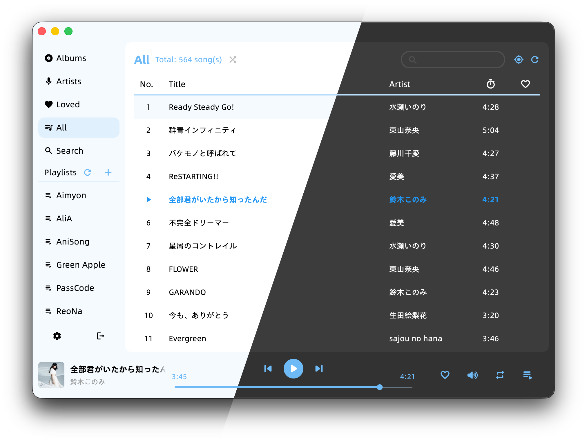
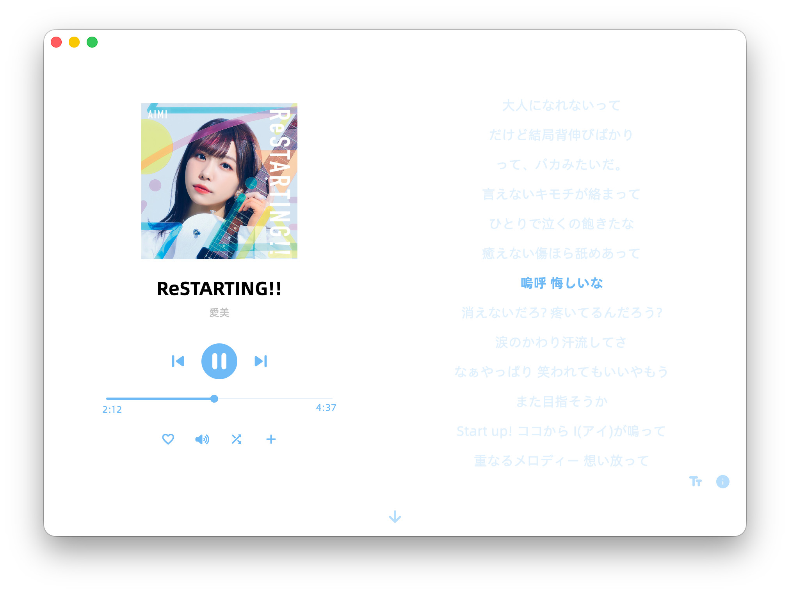

# netPlayer Next

[简体中文](/README.md) | English

## Introduction


[](../DISCLAIMER.md)

<a href="https://apps.microsoft.com/detail/9nfmtfpz1zct?referrer=appbadge&mode=direct">
	
</a>

**netPlayer Next** is a modern desktop music player client based on the Subsonic (Navidrome) API. You can [**click here**](https://www.navidrome.org/docs/installation/) to learn how to set up a Navidrome music server (Recommended).

If you are looking for the mobile version, please visit the [**netPlayer Mobile**](https://github.com/Zhoucheng133/netPlayer-Mobile) repository.

> [!NOTE]
> - Before use, make sure the device running netPlayer can successfully connect to your music server over the network.
> - If you encounter any bugs or have feature suggestions, feel free to open an [Issue](https://github.com/Zhoucheng133/netPlayer-Next/issues).

**★ netPlayer Next** | [**netPlayer Mobile**](https://github.com/Zhoucheng133/netPlayer-Mobile)

## Table of Contents

- [Introduction](#introduction)
- [Screenshots](#screenshots)
- [Features & Usage](#features--usage)
- [Multi-language Support](#multi-language-support)
- [WebSocket Service & Integration](#websocket-service--integration)
- [Frequently Asked Questions (FAQ)](#frequently-asked-questions-faq)
- [Related Links](#related-links)
- [Local Development & Build Guide](#local-development--build-guide)
- [API References](#api-references)

## Screenshots

> [!TIP]
> Custom theme colors and dark mode are now supported!





## Features & Usage

> [!TIP]
> - **Song & Album Limit Note**: Due to Subsonic API limitations, "All Songs" and "Albums" display a maximum of 500 items by default (randomly sampled and sorted).
> - **Navidrome Enhanced Support**: Starting from `v3.6.2`, full listing of "All Songs" and "Albums" for Navidrome servers is supported (enabled by default, checks server capability first).

### Shortcuts

#### In-App Shortcuts
- **`Space`**: Play / Pause
- **`Command` + `→`** (macOS) or **`Ctrl` + `→`** (Windows): Next track
- **`Command` + `←`** (macOS) or **`Ctrl` + `←`** (Windows): Previous track
- **`Command` + `L`** (macOS) or **`Ctrl` + `L`** (Windows): Show / Hide lyrics

#### Global Shortcuts
- **Media Play/Pause** (macOS & Windows) or **`Ctrl` + `Alt` + `Space`** (Windows): Play / Pause
- **Media Next** (macOS & Windows) or **`Ctrl` + `Alt` + `→`** (Windows): Next track
- **Media Previous** (macOS & Windows) or **`Ctrl` + `Alt` + `←`** (Windows): Previous track

### Desktop Floating Lyrics
- You can toggle floating lyrics using the lyric button next to the playback progress bar in the main interface.
- You can also configure this button in the **Settings** page to either show floating lyrics or main page lyrics.
- In the **Settings** page, you can adjust the font size and transparency of the floating lyrics. The lyric color automatically follows the active theme color.

## Multi-language Support

- Multi-language configuration files are located in the `lib/lang` directory.
- Multi-language support has been available since version **v3.2.0**. If you find any translations inaccurate, contributions via PR or Issue are welcome.

## WebSocket Service & Integration

> [!NOTE]
> This feature requires version **v3.0.0** or higher, and the following endpoints apply to version **v3.3.0** or newer.

The default WebSocket server address is: `localhost:9098`

### Sent Messages Format
```json
{
  "title": "<Track Title>",
  "artist": "<Artist>",
  "lyric": "<Current Lyric Line>",
  "cover": "<Album Art URL>",
  "fullLyric": "<Full Lyrics>",
  "line": "<Current Lyric Line Number>",
  "isPlay": <Is Playing>,
  "mode": "<Playback Mode>"
}
```

### Received Messages Format
For detailed implementation, please refer to `lib/views/functions/ws.dart`:
```json
{
  "command": "<Command>",
  "data": "<Data>"
}
```

### Secondary Development Use Case
This feature can be used for live streaming background music display. Steps:
1. Design a Web page / browser source overlay for your live stream.
2. Fetch current playing music and lyric info via the WebSocket service and render it dynamically.

## Frequently Asked Questions (FAQ)

### 1. Cannot connect to the music server?
- First check whether your client device can open the music server web page directly in a browser (most likely a server firewall, port forwarding, or reverse proxy issue).
- Verify that the server address protocol (`http` / `https`) is correct.

### 2. "All Songs" list is incomplete?
- The Subsonic API restricts viewing all songs, returning a maximum of 500 tracks.
- However, you can use the full random play feature to randomly shuffle through all tracks without limit (v2 has it in the left sidebar, v3 has it next to the "All Songs" title).

### 3. Grey blocks or crash when opening pages?
This can happen due to two possible reasons:
1. **Config Conflict**: Conflict between old and new configuration versions.
   - **Solution**: Delete the configuration directories and retry:
     - Windows: `C:\Users\<YourUsername>\AppData\Roaming\zhouc\net_player_next`
     - Windows (Old): `C:\Users\<YourUsername>\AppData\Roaming\zhouc\netPlayer`
2. **API Bug**: An unexpected parameter returned by a Subsonic API.
   - **Recommendation**: Try updating your music server (e.g., updating Navidrome). If the issue persists consistently, please open an Issue.

### 4. Lyrics not found?
- Lyrics rely on online lyrics APIs (see API references below). "Not found" simply means no match was found.
- Lyric matching depends on track title, album, artist, and track duration.

## Related Links

- [MusicDL-GUI](https://github.com/Zhoucheng133/MusicDL-GUI) - Song download utility tool
- [Live-BG](https://github.com/Zhoucheng133/Live-BG) - Background page to display current playing song info and lyrics for live streaming with netPlayer

## Local Development & Build Guide

### Desktop Floating Lyric Dependency (Float-Lyric)
- Repository: [Float-Lyric](https://github.com/Zhoucheng133/Float-Lyric)
- The compiled dynamic library binaries must be placed in their respective directories:
  - macOS: `macos/libFloatLyric.dylib`
  - Windows: `windows/libFloatLyric.dll`

### netPlayer Next App Development
This project is built with **Flutter 3.41+**. It is recommended to use Visual Studio Code with the Flutter and Dart extensions installed. A preset `.vscode/launch.json` is included.

- **Windows Build**:
  ```bash
  flutter build windows
  ```
- **macOS Build**:
  ```bash
  flutter build macos
  ```

### Pull Request (PR) Guidelines
> [!NOTE]
> If you are submitting a PR, please target the **`dev`** branch rather than the `main` branch.

## API References

- [Subsonic API](http://www.subsonic.org/pages/api.jsp)
- [lrclib API](https://lrclib.net/docs)
- Navidrome API
- Netease Cloud Music API
